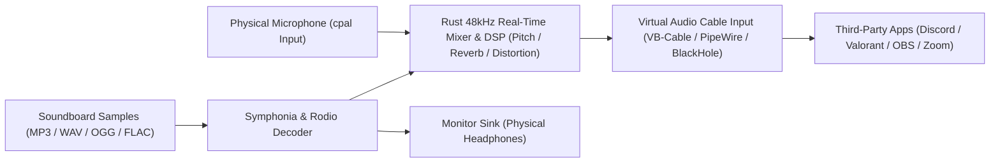

# SonicBoard

**Ultra Low-Latency Desktop Soundboard & Dual-Sink Audio Router**

[](https://v2.tauri.app/)
[](https://www.rust-lang.org/)
[](https://react.dev/)
[](https://www.typescriptlang.org/)
[](https://tailwindcss.com/)
[](./LICENSE)

SonicBoard is a cross-platform desktop soundboard and real-time virtual audio routing console built with **Tauri v2 (Rust)** and **React 19 + TypeScript**. It captures your physical microphone stream, mixes it with triggered audio samples and real-time voice DSP effects, and routes the combined signal into a virtual audio cable for Discord, OBS, Zoom, or competitive games while simultaneously feeding a zero-delay monitor mix to your headphones.

---

## Core Features

- **Native Low-Latency Audio Engine:** Powered by Rust (`cpal` and `rodio` with `symphonia`) using native OS audio backends (WASAPI on Windows, ALSA/PipeWire on Linux, CoreAudio on macOS) running at a `48 kHz` internal sample rate.
- **Dual-Sink Audio Routing:** Mixes your physical microphone input and active soundboard samples in real time and streams the combined buffer into a virtual audio cable (`VB-Audio Virtual Cable`, `VoiceMeeter`, `PipeWire`, or `BlackHole`).
- **Independent Headphone Monitoring:** Routes triggered soundboard samples directly to your physical headphones or DAC with dedicated level control so you hear every sample without latency.
- **System-Wide Global Hotkeys:** Uses a dedicated OS keyboard hook daemon (`rdev` and `global-hotkey`) to capture key combinations (`Ctrl + 1`, `Num 4`, etc.) even when SonicBoard is minimized or running behind a full-screen game.
- **Real-Time DSP Voice & Sample FX:** Includes three interactive rotary processors for **Pitch Shift** (`-12` to `+12` semitones), **Reverb** (Schroeder comb network), and **Distortion** (soft-clipping `tanh` drive).
- **Emergency Panic Mute:** Lock-free `AtomicBool` kill-switch that drops all active playback sinks, flushes the internal mixer queue, and cuts microphone pass-through immediately.
- **20 Hz Peak & RMS Metering:** Streams real-time decibel (`-60 dB` to `0 dB`) and RMS levels every `50 ms` from the Rust audio thread to 14-segment multi-color LED peak meters in the UI.
- **Dual Studio Themes:** Ships with a low-glare **Dark Rack** mode (`#12131A` / `#1A1D26`) for dark-room streaming setups and a high-contrast **Daylight Broadcast** mode, both verified against WCAG AA contrast ratios.

---

## Tech Stack

| Layer | Technology | Role in SonicBoard |
| :--- | :--- | :--- |
| **Desktop Core** | Tauri v2 (`tauri`, `tauri-build`) | Frameless native window management, IPC command bridge, and event emitter |
| **Audio I/O & Routing** | `cpal` `0.15` | Native OS audio device enumeration and low-latency input/output stream capture |
| **Decoding & Playback** | `rodio` `0.19` + `symphonia` | Instant decoding of `MP3`, `WAV`, `OGG`, and `FLAC` files plus 28-bar waveform extraction |
| **Global Shortcuts** | `rdev` `0.5` + `global-hotkey` `0.6` | Background thread keyboard listener for in-game hotkey triggers |
| **State Persistence** | `serde` + `tauri-plugin-store` | Local JSON persistence (`sonicboard-config.json`) for sounds, categories, hotkeys, and routing |
| **Frontend UI** | React 19 + TypeScript 5.7 + Vite 6 | Responsive 3-zone broadcast rack interface, modal workflows, and Web Audio `AnalyserNode` |
| **Styling & Icons** | Tailwind CSS 3.4 + Lucide React | Hardware-style faders, rotary DSP potentiometers, LED peak meters, and vector audio icons |
| **Testing** | Cargo Test + Vitest + Testing Library | Rust unit tests for audio/hotkey state and full DOM click-through verification |

---

## System Architecture



---

## Prerequisites

1. **Virtual Audio Cable Driver (Recommended for Mic Mixing):**
   - **Windows:** [VB-Audio Virtual Cable](https://vb-audio.com/Cable/) or [VoiceMeeter](https://vb-audio.com/Voicemeeter/).
   - **Linux:** PipeWire / PulseAudio virtual null sink (`pactl load-module module-null-sink sink_name=SonicBoardVirtualMic`).
   - **macOS:** [BlackHole 2ch](https://existential.audio/blackhole/).
   - *Note:* If no virtual audio driver is installed on the host machine, SonicBoard automatically falls back to an internal simulated bridge and displays a diagnostic notice so you can still preview and trigger all sound pads locally.
2. **Node.js:** `v20.0+` (tested with `v24.21.0`) and `npm`.
3. **Rust Toolchain:** `stable` (`rustc` and `cargo`) with platform build tools:
   - **Windows:** MSVC Build Tools or LLVM-MinGW (`x86_64-pc-windows-gnu`).
   - **Linux:** `libwebkit2gtk-4.1-dev`, `libasound2-dev`, `build-essential`, `curl`, `wget`, `file`.
   - **macOS:** Xcode Command Line Tools.

---

## Audio Routing Setup Guide (Discord, OBS, Zoom, & Games)

Follow these steps to route your voice and soundboard pads into any communication app or game:

1. **Install a Virtual Audio Cable:** Install VB-Audio Virtual Cable (Windows), BlackHole (macOS), or create a PipeWire virtual sink (Linux).
2. **Configure SonicBoard I/O (Right Sidebar -> Input & Output Routing):**
   - **Physical Mic (Input Stream):** Select your hardware microphone (for example, `FIFINE K688 USB` or `Realtek HD Audio Mic`).
   - **Virtual Mic (Discord / Game / OBS Sink):** Select `CABLE Input (VB-Audio Virtual Cable)`.
   - **Monitor (Headphone Output):** Select your physical headphones or DAC so you can hear your triggered sounds.
3. **Configure Discord / Zoom / In-Game Voice Settings:**
   - Open your application's **Voice & Video** settings.
   - Set **Input Device (Microphone)** to `CABLE Output (VB-Audio Virtual Cable)`.
   - Leave **Output Device (Speaker/Headphones)** set to your physical headphones.
4. **Adjust Levels & Test:**
   - Use the **Virtual Mixer** vertical faders in SonicBoard (`Mic Vol`, `Soundboard`, `Monitor`) to balance your voice against your sound effects, keeping peak levels in the green/yellow zone below `0 dB`.
   - Press **PANIC MUTE** at any time to immediately cut all active sounds and microphone pass-through.

---

## Development & Build Instructions

### 1. Install Dependencies

Clone the repository and install the frontend packages from the project root:

```bash
npm install
```

### 2. Run in Development Mode

Launch the Vite hot-reload server and compile the Tauri v2 desktop window:

```bash
npm run tauri dev
```

To run only the frontend interface in a browser with the Web Audio API synthesis engine:

```bash
npm run dev
```

### 3. Run Verification & Tests

Run the frontend unit and full UI click-through test suite:

```bash
npm test
```

Run the Rust backend unit test suite:

```bash
cd src-tauri
cargo test --lib
```

### 4. Build Standalone Release Executable

Compile and bundle the optimized production binary and platform installer:

```bash
npm run tauri build
```

Release artifacts are written to `src-tauri/target/release/` and `src-tauri/target/release/bundle/`.

---

## Project Structure

```text
SonicBoard/
├── public/
│   └── samples/               # Built-in 44.1kHz 16-bit PCM WAV sample bank
├── src/
│   ├── components/
│   │   ├── AudioControlSidebar.tsx  # I/O routing, 3-ch LED mixer, DSP knobs, Panic Mute
│   │   ├── HeaderBar.tsx            # Transport bar, search, category pills, window controls
│   │   ├── Modals.tsx               # Add/Edit sound modal, hotkey recorder, category modal
│   │   ├── SoundIcon.tsx            # Vector icon mapping for soundboard cards
│   │   └── SoundPadCard.tsx         # Interactive sound pad, 28-bar waveform, mini volume slider
│   ├── lib/
│   │   ├── tauriIpc.ts              # Typed Tauri v2 IPC commands and event listeners
│   │   └── webAudioEngine.ts        # Web Audio API AnalyserNode & real-time DSP graph
│   ├── types/
│   │   └── soundboard.ts            # Shared TypeScript interfaces
│   ├── __tests__/                   # Vitest IPC & full UI click-through tests
│   ├── App.tsx                      # Main application state & keyboard shortcut controller
│   └── main.tsx                     # React 19 entry point
├── src-tauri/
│   ├── capabilities/default.json    # Tauri v2 security permissions
│   ├── src/
│   │   ├── audio/
│   │   │   ├── devices.rs           # CPAL device enumeration & virtual cable detection
│   │   │   ├── engine.rs            # Dual-sink audio mixer, Symphonia decoder, DSP thread
│   │   │   └── mod.rs               # Audio data models
│   │   ├── hotkeys.rs               # Global hotkey registry & rdev key mapping
│   │   ├── store.rs                 # Local JSON persistence & starter sound definitions
│   │   ├── lib.rs                   # Tauri IPC commands, 20Hz meter emitter, unit tests
│   │   └── main.rs                  # Binary entry point
│   ├── Cargo.toml
│   └── tauri.conf.json
├── DESIGN.md                        # Visual design system & WCAG AA contrast specifications
├── LICENSE                          # MIT License (Copyright 2026 Rafael Manik)
└── package.json
```

---

## License

Distributed under the **MIT License**. See [`LICENSE`](./LICENSE) for full license text.

Copyright (c) 2026 Rafael Manik.
